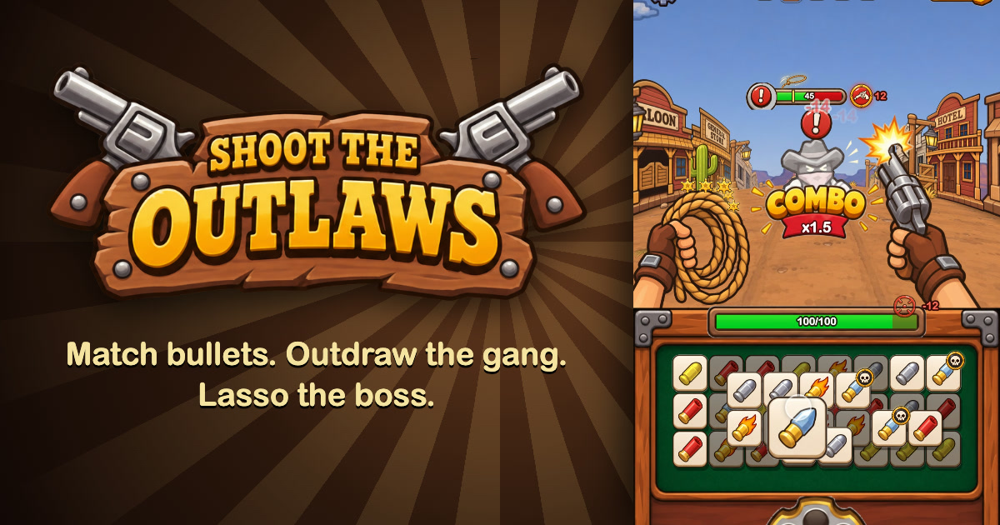

# Shoot the Outlaws

A Wild West tile-matching shootout for your phone. One playable level: Main Street 1.

- Play: https://chrisli328.github.io/shoot-the-outlaws/
- Gameplay video: https://chrisli328.github.io/shoot-the-outlaws/video/

## How to play

Tap bullets on the board to load them into your six-shooter. Three of the same kind fire at the outlaw in the street.
When an outlaw starts to draw, finish a set of three before he shoots and your shot stops his. Fill the lasso, then throw it
at a weak outlaw to catch him alive. Undo, shuffle and the holster help when the cylinder fills up. Clear the street and
capture the boss.

## Running it

It is one HTML file plus its art, with no build step. Open it through any static web server, for example
`python3 -m http.server` in this folder and then http://localhost:8000/ . Opening the file directly from disk will not work,
because the browser blocks image loading there.
